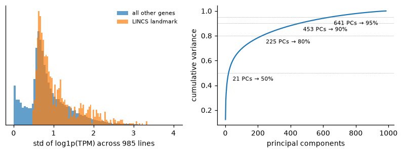

# CCLE feature-space EDA

Generated by `uv run python -m oncora.eda.features`. Do not edit by hand. Scope: the 985 trainable cell lines × 19,215 genes (log1p TPM).

## Gene variability

- Median per-gene std: 0.752; 7 genes are constant.
- 6,735 genes are essentially unexpressed (mean log1p TPM < 1), and 3,418 have std < 0.5.

## LINCS landmark genes

- 978 landmark genes in `geneinfo.txt`; **978 are present in CCLE** (matched on Entrez ID).
- Median std: landmark 0.883 vs. all genes 0.752. Landmarks are selected for being informative about the rest of the transcriptome, and are slightly more variable than average.
- Overlap with the most variable genes is small:

| Top-k by variance | landmark genes inside |
|---|---|
| 500 | 50 |
| 1,000 | 106 |
| 2,000 | 189 |
| 5,000 | 358 |

## Dimensionality (PCA, centered)

| Variance explained | Principal components |
|---|---|
| 50% | 21 |
| 80% | 225 |
| 90% | 453 |
| 95% | 641 |

Variance is spread out: a few components capture broad lineage structure, but 80% needs 225 components.

## Recommendation (decide at the task 6 checkpoint)

The DSS3 decomposition (`eda_target.md`) shows cell-line identity explains only about 4–5% of sensitivity variance. A compact, low-risk cell-line representation is therefore preferable to a large one.

1. **MVP: the 978 landmark genes, standardized with training-fold means and stds.** The gene list is fixed in advance, so there is no selection leakage. It is interpretable, and it keeps the design matrix at ~3k features (2,058 compound + 978 genes).
2. **Comparison (STRETCH):** the top-2,000 variance genes and the first 50–100 PCs, both fit inside each training fold. Keep whichever wins on per-compound ρ.
3. Drop constant genes in any data-driven variant.
