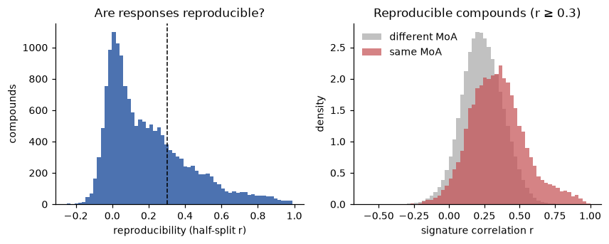

# L1000 Level 4 signatures: profile and validation

Generated by `uv run python -m oncora.eda.signatures` from the extracted consensus table. Do not edit by hand.

**Role (D-09): evidence only.** Measured responses are attached to explanations for compounds LINCS profiled. They are never a model feature, because a new SMILES has no measured signature.

## 1. The file and what was extracted

- `level4_beta_trt_cp_n1805898x12328.gctx`: one uncompressed, unchunked float32 HDF5 matrix, 1,805,898 profiles × 12,328 genes (~89 GB), plate-normalized z-scores, every profile a compound treatment (`trt_cp`). SHA256 `a78b9edb3926fb50fb1af5ac09418615d06cd63b960dc882f43d8d7be19811e6`.
- 978 rows are the measured **landmark** genes; the other 11,350 are computationally inferred and are not used.
- Eligible profiles: QC pass, dose ≥ 1.0 µM, structure in the compound bridge: **801,328**. One sequential pass (~90 s, ~6 GB RAM) reduced them to **20,145 compound consensus signatures** (`data/interim/l1000_consensus.parquet`, ~75 MB), covering 9,963 skeletons. The 89 GB file is not needed after this step.
- Consensus = mean over cell lines of per-cell-line mean z. Profiles per compound: median 9; cell lines per compound: median 2, max 191.

## 2. Coverage of Oncora's compounds

- Sensitivity (DSS3) compounds with a measured signature: **951 / 960**; with a reproducible one: 722.
- Demo compound gefitinib: 858 profiles in 118 cell lines, reproducibility 0.86.
- A new SMILES that LINCS never profiled has none: the evidence is simply absent for it.

## 3. Are responses reproducible?

Reproducibility = correlation between consensus signatures built from two disjoint halves of a compound's cell lines. Of 16,598 compounds profiled in ≥ 2 lines, the median is 0.14, and **4,481 (27%) reach r ≥ 0.3**. Most compounds barely perturb transcription at the doses tested, so their consensus is mostly noise. Only reproducible signatures are offered as "responds like" references, and a query whose own response is irreproducible gets no neighbors.

## 4. Do same-mechanism compounds respond alike?

One compound per skeleton, restricted to compounds with a LINCS MoA annotation. AUC = probability that a same-MoA pair correlates more than a different-MoA pair (0.5 = no information). Top-5 hit = share of compounds whose 5 most similar signatures include a same-MoA compound; shuffled = the same with MoA labels permuted (20×).

| reproducibility filter | compounds | same-MoA pairs | AUC | top-5 hit | top-5 shuffled |
|---|---|---|---|---|---|
| none (≥ 2 lines) | 2,525 | 28,861 | 0.627 | 0.230 | 0.044 |
| r ≥ 0.1 | 2,439 | 27,498 | 0.627 | 0.235 | 0.047 |
| r ≥ 0.2 | 2,167 | 21,222 | 0.641 | 0.251 | 0.046 |
| r ≥ 0.3 | 1,705 | 12,529 | 0.666 | 0.279 | 0.044 |
| r ≥ 0.5 | 822 | 3,707 | 0.763 | 0.372 | 0.062 |

Coherence rises steadily with reproducibility. The cutoff r ≥ 0.3 (`SIG_MIN_REPRODUCIBILITY`) was fixed before this analysis and is kept: it already lifts AUC and top-5 hits above the unfiltered set while keeping about twice as many reference compounds as r ≥ 0.5. Note that MoA annotations are incomplete (several neighbors below are known drugs with no LINCS MoA), so these numbers understate coherence.

**Beyond structure (r ≥ 0.3 set):** ECFP4 Tanimoto alone separates same-MoA pairs with AUC 0.693. Restricted to structurally dissimilar pairs (Tanimoto < 0.3; 1,449,581 pairs, 11,272 same-MoA), the signature AUC is **0.653**: the measured response carries mechanism information that the chemical structure does not.

## 5. Do compounds that respond alike kill the same cell lines?

DSS3 is ranked within each compound and each line's average rank is subtracted (removing generally fragile lines). For every compound pair sharing ≥ 100 lines, the similarity of these residual selectivity profiles is compared with their signature correlation. Mantel test: Spearman ρ over pairs; the null permutes compound labels (200×).

| compounds | pairs | Mantel ρ | null 95th pct | p |
|---|---|---|---|---|
| all (931) | 420,551 | 0.104 | 0.005 | < 0.005 (no permutation reached it) |
| reproducible (702) | 238,863 | 0.118 | 0.004 | < 0.005 (no permutation reached it) |

## 6. Examples (what the evidence bundle shows)

| compound | cell lines | reproducibility | most down-regulated | responds like (r) |
|---|---|---|---|---|
| gefitinib | 118 | 0.86 | CCDC86, CD44, GOLT1B, TUBB6 | lapatinib (EGFR inhibitor, ErbB2 inhibitor, r 0.86); vandetanib (EGFR inhibitor, RET tyrosine kinase inhibitor, VEGFR inhibitor, r 0.77); WZ-4002 (EGFR inhibitor, r 0.75); PD-173074 (FGFR inhibitor, VEGFR inhibitor, r 0.75); erlotinib (EGFR inhibitor, r 0.71) |
| erlotinib | 121 | 0.93 | CCDC86, JMJD6, PNP, CDC20 | RAF-265 (no MoA, r 0.85); dabrafenib (RAF inhibitor, r 0.79); vemurafenib (RAF inhibitor, r 0.76); WHI-P154 (JAK inhibitor, r 0.76); HG-6-64-01 (no MoA, r 0.75) |
| vorinostat | 191 | 0.99 | KEAP1, ADI1, SENP6, PCBD1 | belinostat (HDAC inhibitor, r 0.96); PCI-24781 (HDAC inhibitor, r 0.95); BRD-A19037878 (no MoA, r 0.94); SB-939 (HDAC inhibitor, r 0.94); dacinostat (HDAC inhibitor, r 0.93) |
| bortezomib | 14 | 0.92 | TOP2A, CDK1, CDC25B, UBE2C | MG-132 (Proteasome inhibitor, r 0.96); bortezomib (NFKB pathway inhibitor, Proteasome inhibitor, r 0.96); delanzomib (no MoA, r 0.92); carfilzomib (Proteasome inhibitor, r 0.92); oprozomib (no MoA, r 0.90) |
| trametinib | 103 | 0.96 | DUSP6, FOSL1, DUSP4, MYC | PD-0325901 (MAP kinase inhibitor, MEK inhibitor, Protein kinase inhibitor, r 0.97); selumetinib (MEK inhibitor, r 0.93); AZ-628 (RAF inhibitor, r 0.90); AZD-8330 (no MoA, r 0.90); cobimetinib (no MoA, r 0.89) |
| palbociclib | 102 | 0.98 | TOP2A, NUSAP1, CDK1, CCNB2 | LY-2835219 (no MoA, r 0.76); CGM-097 (no MoA, r 0.75); SAR-405838 (MDM inhibitor, r 0.75); PHA-848125 (CDK inhibitor, Growth factor receptor inhibitor, r 0.73); RG-7388 (no MoA, r 0.73) |

## Use in Oncora

- `annotations.measured_signature` (spec 07 Req 1.4): top up/down landmark genes, profile counts, reproducibility, and up to 5 "responds like" compounds with their LINCS names, MoAs and targets.
- `derived.signature_target_overlap`: predicted targets that are annotated targets of those neighbors. The structure-based prediction and the measured cell response are independent, so agreement is worth showing, but it remains correlational.
- Never a model feature: `assert_structure_only` rejects any signature column (FR-10).
