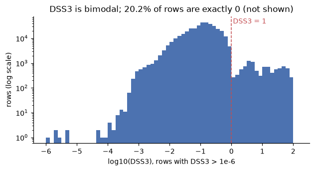
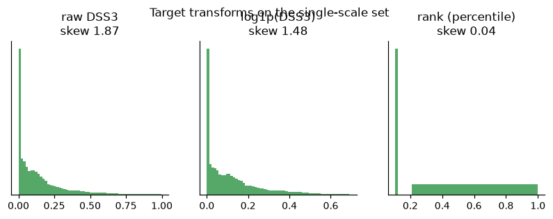
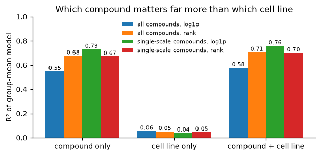

# DSS3 target EDA

Generated by `uv run python -m oncora.eda.target`. Do not edit by hand. Scope: the 493,311 DSS3 rows on the 985 cell lines that also have CCLE expression.

## 1. DSS3 is not on a single scale

- 20.2% of rows are exactly 0. The rest form a main mode around 0.1 and stop sharply at 1. A separate population runs up to 96.
- **Every one of the 9,711 rows with DSS3 ≥ 1 belongs to just 22 of 972 compounds.** Excluding them, the maximum is 0.995.
- Those compounds are mostly the reference drugs of the original CCLE drug screen (PD-0325901, panobinostat, paclitaxel, topotecan, lapatinib, crizotinib, selumetinib, saracatinib, tanespimycin, NVP-AEW541, NVP-TAE684, RAF-265, PHA-665752 …). Most are measured on 474–964 cell lines, against a typical ~460. Overall, 173 compounds exceed 700 lines, consistent with several studies merged per compound.
- Within one of these compounds, values both above and below 1 occur (topotecan: about half each). The likeliest explanation is that PharmacoDB merged studies reporting DSS3 on different scales (≈0–1 vs ≈0–100). **For these compounds, a value's scale cannot be recovered row by row.** A value of 0.5 could be 0.5 on the 0–1 scale or 0.005 on the 0–100 scale.

**Consequence:** a global threshold at 1 would mostly label *came from the CCLE screen*, not *sensitive*, and the raw values of these compounds would dominate any regression loss.

| pert_id | name | lines | rows ≥ 1 | median | max |
|---|---|---|---|---|---|
| BRD-A50454580 | PD-0325901 | 474 | 96% | 12.9 | 94 |
| BRD-K20696416 | NVP-AEW541 | 645 | 73% | 3.86 | 55.1 |
| BRD-K95435023 | PHA-665752 | 638 | 68% | 2.4 | 67.6 |
| BRD-K50140147 | NVP-TAE684 | 774 | 61% | 3.95 | 85.9 |
| BRD-K93123848 | RAF-265 | 776 | 55% | 3.73 | 66.6 |
| BRD-K02130563 | panobinostat | 864 | 54% | 42.1 | 91.4 |
| BRD-K49865102 | PD-0325901 | 843 | 54% | 2.4 | 94 |
| BRD-K81473043 | tanespimycin | 874 | 54% | 12.4 | 91.4 |
| BRD-K19540840 | saracatinib | 853 | 53% | 1.7 | 78.9 |
| BRD-U07805514 | saracatinib | 853 | 53% | 1.7 | 78.9 |
| BRD-K55696337 | topotecan | 946 | 50% | 0.906 | 89.6 |
| BRD-K62008436 | paclitaxel | 950 | 50% | 0.985 | 96 |
| BRD-K57080016 | selumetinib | 945 | 49% | 0.678 | 91.4 |
| BRD-K78431006 | crizotinib | 955 | 49% | 0.562 | 69.9 |
| BRD-K19687926 | lapatinib | 951 | 48% | 0.462 | 56.8 |
| BRD-M07438658 | lapatinib | 951 | 48% | 0.462 | 56.8 |
| BRD-K23984367 | sorafenib | 953 | 47% | 0.402 | 85 |
| BRD-K16478699 | PLX-4720 | 951 | 46% | 0.233 | 67.5 |
| BRD-K70401845 | erlotinib | 964 | 45% | 0.352 | 63.3 |
| BRD-K51313569 | palbociclib | 870 | 43% | 0.292 | 35 |
| BRD-K81528515 | nilotinib | 950 | 39% | 0.148 | 90.5 |
| BRD-K08547377 | irinotecan | 832 | 36% | 0.322 | 91.4 |

## 2. Distribution and transforms

| Quantile | all rows | single-scale compounds |
|---|---|---|
| p50 | 0.08586 | 0.08017 |
| p75 | 0.1986 | 0.1861 |
| p90 | 0.4073 | 0.3591 |
| p95 | 0.5784 | 0.4886 |
| p97.5 | 0.8216 | 0.602 |
| p99 | 7.725 | 0.735 |
| p99.9 | 68.22 | 0.9376 |

On the single-scale set, raw DSS3 has skew 1.87, log1p has 1.48, and ranks are uniform by construction. log1p barely helps once values are confined to [0, 1], because log1p is nearly linear there. Most of the skew comes from the zero spike plus the long tail toward 1.

## 3. Variance decomposition: compound vs. cell line

| Data, transform | compound only | cell line only | compound + cell line (additive) |
|---|---|---|---|
| all compounds, log1p | 0.550 | 0.055 | 0.580 |
| all compounds, rank | 0.679 | 0.052 | 0.707 |
| single-scale compounds, log1p | 0.732 | 0.041 | 0.760 |
| single-scale compounds, rank | 0.673 | 0.046 | 0.702 |

- **Compound identity explains most of the variance; cell-line identity explains about 4–5%.** This holds with and without the mixed-scale compounds and under both transforms.
- The additive model leaves about 24–30% for compound × cell-line interaction plus noise. That remainder is the selectivity signal: which lines respond more than the compound's average.
- Per-compound mean DSS3 (single-scale) ranges 0.000–0.822. Predicting this overall potency from structure is most of the achievable signal for an unseen compound.

Implications for specs 04 and 06:

1. The **cell-line-mean baseline is weak** (R² ≈ 0.04), not strong as spec 06 assumed. Beating it is necessary but far from sufficient.
2. **Per-cell-line ρ** (ranking compounds within a line) mostly measures predicted potency, the dominant, structure-driven component. **Per-compound ρ** (ranking lines for one compound) measures selectivity, the smaller and harder component. Report both and interpret them separately.
3. Add a **compound-features-only ablation**. If the full model does not beat it on per-compound ρ, the cell-line features add nothing, and the cell-line rankings shown to users would amount to the compound's potency plus the line's average.

## 4. Sensitive/resistant threshold: candidates

There is no natural break inside the single-scale data (the only break, at 1, is the scale artifact).

| Candidate | Definition | Positive rate | Measures |
|---|---|---|---|
| A. Global p90 | DSS3 ≥ 0.359 (single-scale set) | 10% | potent compound × responsive line; dominated by potent compounds |
| B. Global p95 | DSS3 ≥ 0.489 | 5% | same, stricter |
| C. Within-compound top decile | line is in the top 10% of that compound's lines | 10% of each compound | selectivity: which lines respond most to *this* compound, which matches the product question |

**Recommendation (decide at the task 6 checkpoint):**

- Exclude the mixed-scale compounds from headline training and evaluation, list them in the model card, and report one sensitivity analysis that includes them after rescaling values ≥ 1 by 1/100.
- Regression target: rank-transformed DSS3 (robust to the zero spike and any residual scale differences). Headline: Spearman ρ.
- Classification label: **C (within-compound top decile)** as the product-facing metric, with A reported for comparison.
